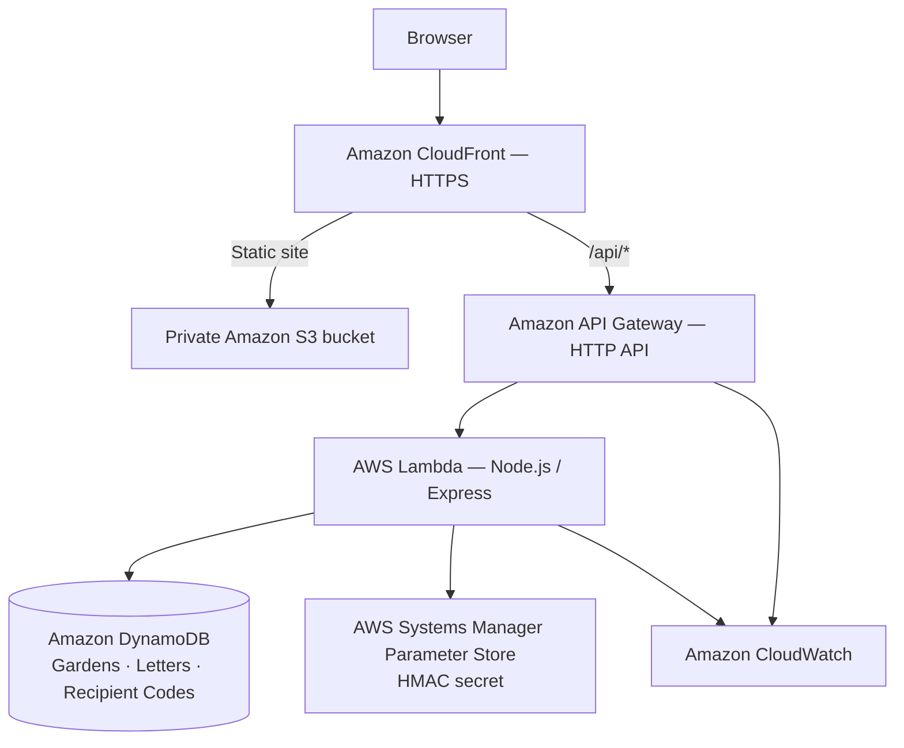

# Letter4You — Serverless Cloud-Native Application on AWS

Letter4You is a web application for creating private gardens, writing personalized letters, and sharing them using recipient access codes. This repository demonstrates the evolution of a React/Express application from a containerized PostgreSQL deployment to a serverless architecture on AWS.

## Architecture



- **Frontend:** React + Vite, hosted on private S3, served through CloudFront with Origin Access Control (OAC).
- **Backend:** Express on AWS Lambda (Node.js 22), exposed through API Gateway HTTP API.
- **Data:** DynamoDB tables for gardens, letters and recipient codes, with on-demand capacity.
- **Secrets and permissions:** SSM Parameter Store and scoped IAM roles.
- **Infrastructure as Code:** AWS SAM / CloudFormation.
- **Observability:** CloudWatch dashboard, API Gateway access logs and an API 5xx alarm (initially configured in the AWS Console).

The application uses accountless management links and recipient access codes rather than conventional user accounts. Management tokens should be treated as secrets. No user letters or access credentials should be added to the repository.

## CI/CD

### Backend — AWS CodePipeline

`GitHub source → CodeBuild unit tests + SAM build/package → CloudFormation change set → Manual approval → Deploy Lambda → Live API smoke test`

Source: `feature/aws-serverless-dynamodb` until the final release switches the pipeline to `main`.

- Pipeline template: [`infra/backend-cicd-template.yaml`](infra/backend-cicd-template.yaml)
- Buildspec: [`backend-buildspec.yml`](backend-buildspec.yml)
- Post-deployment verification: [`backend-smoke-buildspec.yml`](backend-smoke-buildspec.yml)
- Smoke test: [`backend/scripts/smoke-cloud-api.mjs`](backend/scripts/smoke-cloud-api.mjs)

The smoke test writes and attempts to remove temporary synthetic garden and letter records in the **development** DynamoDB tables. It should not be run indiscriminately against production data.

### Frontend — AWS CodePipeline

`GitHub source → CodeBuild React build → Manual approval → Deploy build artifact to S3`

The frontend pipeline was configured through the AWS Console. Its exact deployed configuration should be documented or exported before claiming full IaC reproducibility. Confirm CloudFront invalidation behavior separately; do not assume the existing pipeline automatically invalidates cached files.

- Buildspec: [`buildspec.yml`](buildspec.yml)
- Hosting infrastructure: [`infra/frontend-template.yaml`](infra/frontend-template.yaml)

## Local validation

Requires Node.js 22 and npm.

```bash
npm ci --prefix frontend
npm run build --prefix frontend

npm ci --prefix backend
npm test --prefix backend
```

The backend unit tests do **not** require DynamoDB Local. End-to-end AWS behavior is verified by the deployed API smoke test.

## Infrastructure files

| File | Purpose |
|---|---|
| `infra/template.yaml` | DynamoDB tables |
| `infra/api-template.yaml` | Lambda and HTTP API |
| `infra/frontend-template.yaml` | S3 hosting and CloudFront |
| `infra/backend-cicd-template.yaml` | Backend CodePipeline, CodeBuild, IAM and artifact storage |

The frontend delivery pipeline is managed separately in the AWS Console. Do not deploy alternate experimental CI/CD templates without reviewing their impact.

## Live application

- **Website URL:** Retrieve `WebsiteUrl` from CloudFormation stack `letter4you-dev-web` in `eu-north-1`.
- **API URL:** Retrieve `ApiHealthUrl` from CloudFormation stack `letter4you-dev-api`.
- **Monitoring:** CloudWatch dashboard `letter4you-dev-overview`.

The project runs in AWS region **eu-north-1 (Stockholm)**. URLs and account-specific identifiers are intentionally not hardcoded in this README.

## Security and operations

- S3 website bucket is private and accessible through CloudFront OAC.
- API Gateway throttling is defined in the SAM template.
- DynamoDB `DeletionPolicy` and `UpdateReplacePolicy` are set to `Retain` in source code; check that the **deployed** database stack matches this before relying on it.
- CloudWatch Logs retention limits log-storage growth.
- A cost budget is configured in the AWS account; **budget notifications are not spending caps**.
- `Retain` protects resources from certain CloudFormation deletion scenarios, but is **not** a database backup. Evaluate DynamoDB PITR or backup requirements before hosting irreplaceable personal content.
- The public `/health/db` endpoint is for development diagnostics; review or restrict it before production exposure.

## Release status

The migration is implemented on `feature/aws-serverless-dynamodb`. Before marking the project finished: verify the current AWS stack states and pipeline executions, review/remove unused experimental resources, open a PR into `main`, then update both CodePipeline source branches to `main`.

See [`docs/FINALIZATION.md`](docs/FINALIZATION.md) for a concise closeout checklist.
