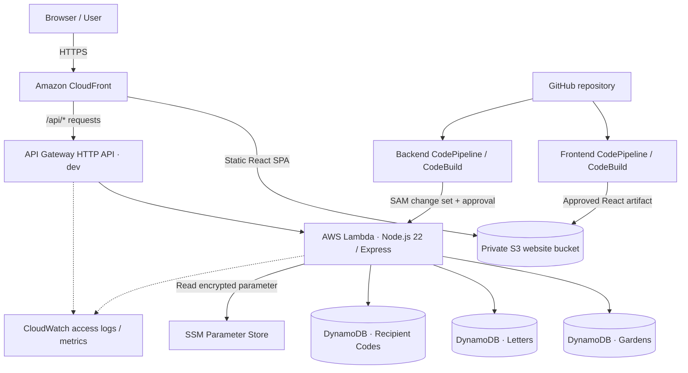
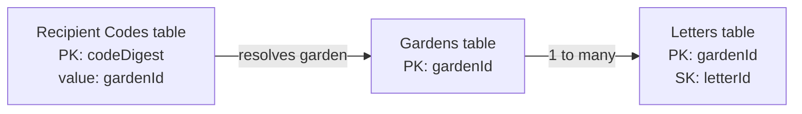
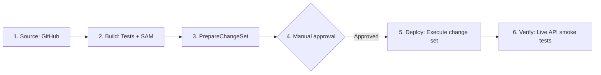

# Letter4You — From a Dockerized Web App to an AWS Serverless Platform

> **A cloud-native migration project:** redesigning an existing React/Express application around AWS managed services, infrastructure as code, automated delivery, security controls, and observability.

Letter4You lets people create a **private garden**, write personalized letters inside it, customize their presentation, and share the garden through a **recipient access code**. The project started as a traditional full-stack application with React, Express, PostgreSQL, Prisma and Docker Compose. The current implementation runs as a serverless application on **AWS, in `eu-north-1` (Stockholm)**.

The objective was not simply to put a web app on AWS. It was to **change the way the application is deployed and operated**: migrate the database, preserve the product's behavior, automate infrastructure and releases, enforce permissions, test the real deployed API, and make the application observable without maintaining servers.

**Project status:** the serverless migration has been merged into `main`. The application and backend delivery pipeline have been deployed and exercised; live CodePipeline source-branch configuration and remaining operational controls must still be verified in AWS.

**Technical documentation:** [Overview](docs/README.md) · [Architecture](docs/architecture.md) · [Data model & API](docs/data-and-api.md) · [CI/CD](docs/cicd.md) · [Infrastructure](docs/infrastructure.md) · [Security & monitoring](docs/security-and-observability.md) · [Operations](docs/operations.md)

## Contents

1. [What the application does](#1-what-the-application-does)
2. [Starting point and migration objectives](#2-starting-point-and-migration-objectives)
3. [Current architecture](#3-current-architecture)
4. [The engineering journey](#4-the-engineering-journey)
5. [DynamoDB data model and application logic](#5-dynamodb-data-model-and-application-logic)
6. [CI/CD pipelines](#6-cicd-pipelines)
7. [Testing and verification](#7-testing-and-verification)
8. [Security, operations and cost awareness](#8-security-operations-and-cost-awareness)
9. [Challenges encountered and solutions](#9-challenges-encountered-and-solutions)
10. [Repository structure and developer commands](#10-repository-structure-and-developer-commands)
11. [Architecture decisions, boundaries and remaining checks](#11-architecture-decisions-boundaries-and-remaining-checks)

---

## 1. What the application does

Letter4You has two distinct user experiences, without requiring conventional user accounts:

**Garden owner / writer**

1. Creates a private garden with a name and optional description.
2. Receives a **management token/link** and a separate **recipient code**.
3. Saves or imports the private management link to manage the garden from a browser.
4. Writes letters, optionally supplies recipient/sender names, and can choose anonymous authorship.
5. Customizes envelopes, paper, colors, typography, themes and decorative elements.
6. Views and deletes letters, edits garden metadata, or deletes the entire garden.

**Recipient / reader**

1. Enters the recipient code, **not** the management token.
2. Opens the garden and reads its available letters.
3. Does not receive the writer's management capabilities; an anonymous letter's sender name is hidden from the recipient view.

This separation matters throughout the backend design: a recipient code grants **read access**, whereas the cryptographically generated management token authorizes **write and delete operations**. The application deliberately does not recreate the login/register system used in its earlier implementation.


## 2. Starting point and migration objectives

### Before the AWS migration

| Layer | Original approach | Current AWS approach |
|---|---|---|
| Frontend | React/Vite, containerized with Nginx | React/Vite static build on private S3, served by CloudFront |
| Backend | Express API in a Docker container | Express API on Node.js 22 AWS Lambda, adapted with `serverless-http` |
| Data | PostgreSQL accessed through Prisma | Three purpose-built DynamoDB tables accessed through AWS SDK v3 |
| Runtime/deployment | Docker Compose / container workflow | AWS managed services, SAM and CloudFormation |
| Delivery | Earlier container-based workflow and GitHub Actions | AWS CodePipeline, CodeBuild and controlled CloudFormation deployment |
| Observability | Container/runtime logs | CloudWatch metrics, dashboard, alarms and API access logs |

The earlier Docker/Prisma/PostgreSQL project provided the **application and product behavior**. The serverless branch is a **re-architecture of its runtime and data-access layer**, not a claim that all historical PostgreSQL records were imported into DynamoDB. There is no automated legacy-data backfill in this repository.

### Design goals

- Keep the garden/letter user journeys while eliminating the need to operate a database server or application VM.
- Use managed AWS components appropriate for a small, potentially unpredictable traffic pattern.
- Make infrastructure and backend deployments repeatable with **SAM/CloudFormation**.
- Learn and validate AWS services **through the Console**, while recording durable infrastructure definitions in Git.
- Build an AWS-native CI/CD workflow with **manual approval for deployments**.
- Keep cloud costs visible and avoid unnecessary environments or services.
- Use actual AWS behavior—not only a successful build—as the final backend deployment check.

## 3. Current architecture



### Why each service is present

| AWS service | Responsibility | Design detail |
|---|---|---|
| **S3** | Store the compiled React site | Bucket is private; public website access is through CloudFront OAC, not public S3 objects |
| **CloudFront** | HTTPS entry point and static asset delivery | Separate origin behavior for `/api/*`; caching disabled for API requests; SPA route rewriting via CloudFront Function |
| **API Gateway (HTTP API)** | Public backend endpoint | `dev` stage, explicitly declared routes, request throttling |
| **Lambda** | Execute the existing Express backend | Node.js 22, 256 MB memory, 10-second timeout in SAM template |
| **DynamoDB** | Store gardens, letters and recipient-code lookups | On-demand (`PAY_PER_REQUEST`) tables, conditional writes and transactions |
| **SSM Parameter Store** | Hold the HMAC signing/digest key | SecureString retrieved by the Lambda role, then cached in the warm execution environment |
| **IAM** | Bound service actions to necessary resources | Table-scoped DynamoDB access, parameter read permission, scoped pipeline execution roles |
| **CloudFormation / SAM** | Describe and update backend + hosting infrastructure | Separate stacks for database, API, web and backend CI/CD |
| **CodePipeline / CodeBuild** | Automate builds and deployments | Approval gates; SAM change sets for backend; real API smoke verification |
| **CloudWatch / SNS** | Visibility and error notification | Dashboard, API 5xx alarm, Lambda metrics and API access logging |

CloudFront has two origins: the **private S3 website** and the **API Gateway endpoint**. Its `/api/*` behavior forwards browser application requests to the API Gateway origin, with `/dev` configured as the origin path. This gives the frontend a same-origin API path rather than requiring a hardcoded API URL in the browser bundle.

The API's direct health endpoint is exposed at the API Gateway URL; it is not part of the CloudFront `/api/*` routing behavior.

## 4. The engineering journey

This section records the work in implementation order, including the reasons behind each change.

### Phase 1 — Understand and isolate the existing application

We began with a working React/Express project using Prisma and PostgreSQL. The first task was to identify the behavior that **had to survive** migration: garden creation and management, private access tokens, recipient codes, letter creation and reading, and deletion. The frontend and backend were then prepared for a backend storage change without redesigning the visible application from scratch.

The original container-based setup remains part of the project's history, but Docker Compose is not required to run the **deployed AWS architecture**. Some historical Dockerfiles remain as legacy development artifacts; they are not used by the current AWS pipelines.

### Phase 2 — Provision DynamoDB through infrastructure as code

The first serverless resources were the DynamoDB tables in [`infra/template.yaml`](infra/template.yaml), deployed through SAM/CloudFormation:

- `letter4you-dev-gardens`
- `letter4you-dev-letters`
- `letter4you-dev-recipient-codes`

We used **on-demand capacity** rather than provisioning a fixed read/write throughput. The schema deliberately follows the operations the application performs, not a direct table-for-table SQL translation.

An early, separate IAM/Lambda smoke test was used to prove that an AWS function could read the gardens table. The experimental infrastructure is preserved in [`infra/app-template.yaml`](infra/app-template.yaml) and `infra/smoke/`; it is **not the main application Lambda**. It should only be removed from AWS after checking the real stack inventory.


### Phase 3 — Replace Prisma/PostgreSQL access with DynamoDB operations

The serverless backend introduces [`backend/src/config/dynamodb.js`](backend/src/config/dynamodb.js), database repositories and DynamoDB-specific services.

Important behavior implemented during the cutover:

- Transactionally create a garden **and** its recipient-code lookup record.
- Look up a recipient code by a keyed digest instead of scanning gardens.
- Check that the garden owner has the correct management token before protected operations.
- Use conditional writes and transactions when creating letters.
- Prevent new writes while deleting a garden and support resuming a partially completed deletion.
- Support **idempotent letter creation**: retrying the same request ID should return the existing letter instead of creating a duplicate.

We also corrected a real frontend/backend integration bug: the frontend initially sent `x-request-id`, but the Express route read `idempotency-key`. The final client and live smoke test now use **`idempotency-key`** consistently.

### Phase 4 — Deploy Express on Lambda behind API Gateway

Rather than rewriting the application as multiple functions, the existing Express router was adapted for Lambda using `serverless-http` and [`backend/src/lambda.js`](backend/src/lambda.js).

[`infra/api-template.yaml`](infra/api-template.yaml) defines the Lambda function, HTTP API, the `dev` stage, route mappings, IAM permissions, environment variables, and its log group.

During deployment we investigated the interaction between API Gateway stage prefixes and Express routing. The `/dev` stage and the backend routes needed to align for the deployed endpoints to work. Both `/health` and `/health/db` were subsequently verified, establishing the path:

`API Gateway → Lambda → Express → DynamoDB`

The backend can still run as a conventional Node.js server for development, but the AWS deployment uses the Lambda handler.

### Phase 5 — Deploy the frontend using S3 and CloudFront

[`infra/frontend-template.yaml`](infra/frontend-template.yaml) provisions:

- A private website S3 bucket.
- CloudFront Origin Access Control (OAC) and a restricted bucket policy.
- A CloudFront distribution serving the React build over HTTPS.
- A second CloudFront origin for API Gateway, with `/dev` as the origin path.
- A CloudFront Function that rewrites browser navigation for React Router routes to `index.html`.

We built the React app with `VITE_API_URL=/api`, published the files to S3 and tested the live website's garden and letter flows through CloudFront. No public S3 website endpoint is required.

### Phase 6 — Build AWS-native CI/CD

We kept **two pipelines** because a frontend asset release and a backend infrastructure release have different deployment mechanisms.

The frontend pipeline was first set up in the **AWS Console** to understand CodeConnections, CodeBuild, CodePipeline artifact handling, manual approvals and S3 deployment. We troubleshot GitHub repository visibility, pipeline IAM permissions, and the relationship between source, build, approval and deployment stages.

The backend pipeline was subsequently defined in **CloudFormation**, using SAM packaging, reviewed change sets, scoped roles, manual approval and execution of the approved backend update. An IAM issue around allowing CloudFormation to use the `Serverless-2016-10-31` transform was fixed in the backend pipeline execution role.

A practical lesson was that a branch-based frontend source trigger can react to **backend-only commits**. Path filtering was discussed as an improvement, but is not claimed as implemented in the live pipeline.

We deliberately chose **AWS CodePipeline + CodeBuild**, not a second GitHub Actions/Jenkins pipeline, for the deployed architecture. The older container-focused GitHub Actions workflow was removed during cleanup.

### Phase 7 — Add tests that prove actual AWS behavior

The first backend pipeline packaged code but did not execute meaningful automated application tests. We added:

1. Fast Node.js unit tests for request validation, recipient-code normalization and management-token generation.
2. SAM validation and build/package steps in CodeBuild.
3. A post-deployment CodeBuild **Verify** stage that calls the real HTTP API.

The cloud smoke test checks health, database connectivity, garden creation, rejection of an invalid management token, letter creation, idempotent retries, recipient unlocking, and synthetic-data cleanup. It fails if assertions or cleanup fail.

We considered DynamoDB Local and a dedicated staging environment, but **did not add either to the final CI pipeline**. The current smoke test uses temporary data in the existing **development** DynamoDB tables and removes it at the end.

A backend pipeline execution was observed with all six stages reporting **Succeeded**, including manual approval, deploy and Verify. This is evidence for the exercised development pipeline, not a claim of exhaustive production-grade testing.

### Phase 8 — Add basic monitoring, security and cost awareness

Through the AWS Console we configured and examined:

- CloudWatch dashboard `letter4you-dev-overview` with Lambda, API Gateway and DynamoDB metrics.
- API Gateway **5xx** CloudWatch alarm `letter4you-dev-api-5xx-alarm`, with an SNS notification flow configured (email subscription confirmation should be checked separately).
- API Gateway access logging for the `dev` stage to `/aws/apigateway/letter4you-dev-access`, with **7-day retention**; delivery was confirmed by a generated log stream.
- Existing AWS budget `letter4you-cost-guard`, configured for **$1**. A budget generates alerts; it is **not a hard cost cap**.

The SAM template already limits HTTP API request rate to **2 requests/second, burst 5**, sets a **10-second Lambda timeout**, and keeps Lambda logs for **3 days**. The DynamoDB templates define `DeletionPolicy: Retain` and `UpdateReplacePolicy: Retain`; source definitions should be checked against the **deployed database stack** before relying on them.

We discussed setting Lambda reserved concurrency, but it is not present in the current SAM template, so this README does **not** claim that a concurrency cap is deployed.


## 5. DynamoDB data model and application logic



| Table | Key | Why it exists |
|---|---|---|
| **Gardens** | `gardenId` (partition key) | Garden metadata, status, management-token hash and recipient-code digest |
| **Letters** | `gardenId` (partition) + `letterId` (sort) | Efficient queries of letters belonging to a garden |
| **Recipient Codes** | `codeDigest` (partition key) | Direct lookup from a recipient's access code to its garden |

**Management-token security:** the application generates a random 32-byte token, keeps its **SHA-256 hash** in the garden record, and compares digests with timing-safe comparison when authorizing writer operations. The browser stores the management token in `localStorage`; management links encode it in the URL fragment, then remove the fragment from the visible address after import. It is still a sensitive capability token, and losing it can mean losing management access.

**Recipient codes:** codes are normalized before computing an **HMAC-SHA-256 digest** with a stable secret loaded from SSM Parameter Store. The digest is used to find the target garden. Recipient access is independent of owner access; sharing a recipient code does not grant permission to manage the garden.

**Atomicity and retries:** DynamoDB transactions couple garden creation with recipient-code creation, and check garden state before inserting letters. The client sends an `idempotency-key` for letter creation; the server uses it as the letter ID and can return the existing letter for an identical retry.

**Deletion:** a garden transitions to `DELETING` before letter/code cleanup, so fresh letter writes are blocked. Cleanup is synchronous in the current 10-second Lambda and is intended for modestly sized gardens; very large gardens would require a different strategy. Letter expiry is applied when returning letters to readers; it is not equivalent to a configured DynamoDB TTL job that physically deletes expired records.


## 6. CI/CD pipelines

### Backend pipeline — CloudFormation managed

**Pipeline:** `letter4you-dev-backend-cicd-pipeline`  
**Target stack:** `letter4you-dev-api`  
**Source branch in the current template:** `feature/aws-serverless-dynamodb`




| Stage | What actually happens |
|---|---|
| **Source** | Reads the configured GitHub branch via an AWS CodeConnections connection |
| **Build** | `npm ci`, Node syntax checks, unit tests, SAM validation, build and package; uploads Lambda artifacts to an S3 artifact bucket |
| **PrepareChangeSet** | Creates/replaces a CloudFormation change set for the existing API stack |
| **Approve** | A person reviews and authorizes the proposed changes |
| **Deploy** | Executes the approved change set, updating the existing Lambda/API stack |
| **Verify** | Reuses CodeBuild with a different buildspec to run the real AWS API smoke test |

**Key files:** [`infra/backend-cicd-template.yaml`](infra/backend-cicd-template.yaml), [`backend-buildspec.yml`](backend-buildspec.yml), [`backend-smoke-buildspec.yml`](backend-smoke-buildspec.yml), [`backend/tests/validators.unit.test.mjs`](backend/tests/validators.unit.test.mjs) and [`backend/scripts/smoke-cloud-api.mjs`](backend/scripts/smoke-cloud-api.mjs).

The CloudFormation execution role is scoped to the existing API stack and its expected AWS resources. **Do not delete the backend CI/CD stack or role without checking the API stack's associated CloudFormation service role.** The pipeline's build artifact bucket uses a lifecycle expiration policy.

### Frontend pipeline — Created in AWS Console

**Pipeline:** `letter4you-console-lab`  
**Source:** GitHub CodeConnections  
**Build artifact:** compiled `frontend/dist` from [`buildspec.yml`](buildspec.yml)

`GitHub → CodeBuild → Manual approval → S3 deployment`

The frontend pipeline is a Console-created CodePipeline V2 workflow, whereas the backend pipeline is V1 and defined through CloudFormation. This was an intentional hands-on learning choice, but it means the **live frontend pipeline is not fully reproducible from this repository alone**.

CloudFront invalidation has been performed manually during frontend releases; automatic invalidation in the live Console pipeline was discussed but **not verified as installed**. The unused alternative frontend pipeline template was removed rather than deployed as a duplicate.

**After merging to `main`:** update *both* pipeline source branches. The backend change belongs in the CloudFormation pipeline's `Branch` parameter; the frontend change belongs in its Console source/trigger configuration. Review the change before execution, because source updates can trigger new pipeline runs.

## 7. Testing and verification

### Fast tests before backend deployment

```bash
npm ci --prefix backend
npm test --prefix backend
```

The `npm test` script runs the current Node test suite for validators, access-code normalization and generated management tokens. It intentionally does **not** start DynamoDB Local.

### Frontend build check

```bash
npm ci --prefix frontend
npm run build --prefix frontend
```

The frontend pipeline's current `buildspec.yml` installs dependencies, runs selected backend syntax checks and produces a React build artifact. It does **not** claim to execute a full browser end-to-end test suite.

### Live AWS smoke verification

The backend pipeline's **Verify** stage injects `API_BASE_URL` and runs:

```bash
node backend/scripts/smoke-cloud-api.mjs
```

For a manual development-only smoke run, obtain the API URL from CloudFormation and supply it as `API_BASE_URL`. This test performs **real writes and deletes** in the selected environment: use the development API, never an unknown production endpoint.

| Verification | Expected behavior |
|---|---|
| Health check | HTTP 200 |
| DynamoDB connectivity check | HTTP 200 |
| Create a synthetic garden | HTTP 201 |
| Incorrect management token | HTTP 403 |
| Create a letter | HTTP 201 |
| Repeat the same `idempotency-key` | Same letter ID; no duplicate |
| Unlock with generated recipient code | One letter visible |
| Delete synthetic garden | HTTP 200; cleanup failure makes test fail |


**What these tests do not prove:** automated browser journeys, multi-region recovery, high-volume performance, complete IAM/security assurance or a working production backup/restore procedure.

## 8. Security, operations and cost awareness

### Implemented safeguards

- **Private S3 + CloudFront OAC:** browser assets are delivered through CloudFront, not anonymous S3 read access.
- **Separate owner/recipient credentials:** no account database; sensitive management operations require a secret token.
- **Hashed/HMAC credentials:** management tokens are stored as hashes; recipient codes use keyed digests.
- **SSM Parameter Store:** the HMAC key is not committed to the repository.
- **Scoped IAM:** application access is limited to the three DynamoDB tables and required parameter.
- **Request validation:** Zod schemas validate garden and letter inputs; Express adds security headers and basic rate limiting.
- **Gateway throttling:** the API's `dev` stage declares 2 req/s with burst 5. These are throttling targets, **not a guarantee of a hard spending limit**.
- **Resource retention in IaC:** all three DynamoDB table resources have `Retain` policies in source.
- **Operational visibility:** CloudWatch dashboard, API 5xx alarm, Lambda logs and API Gateway access logs.
- **Budget:** existing `letter4you-cost-guard` alert at $1, covering account spending according to its configured scope.

### Production considerations / deliberately not claimed as complete

- Source-level `Retain` policies are **not backups**, and DynamoDB point-in-time recovery is **not confirmed as enabled**.
- The production-like `dev` API has public `/health/db` diagnostics; remove or restrict before production.
- CloudWatch dashboard/alarm and API stage access logging were set up in the Console and are **not fully reflected in the API IaC template**. A later SAM deployment should be reviewed for configuration drift.
- SNS email subscription confirmation and Lambda reserved concurrency must be checked in AWS; this README does not assert either is completed.
- Browser `localStorage` retains management credentials; browser security/XSS and token-loss implications remain important.
- Garden deletion is synchronous; load testing and large-scale deletion are outside the verified scope.
- The application has **no dedicated AWS staging environment**, WAF, custom domain, multi-region design or automated disaster-recovery test. Those were not needed to prove the current development deployment.

## 9. Challenges encountered and solutions

This table records concrete engineering problems addressed during the migration—not an idealized, first-try deployment.

| Challenge | Why it mattered | What we changed / learned |
|---|---|---|
| **PostgreSQL/Prisma to DynamoDB** | Relational queries and schema assumptions do not map directly to DynamoDB access patterns | Split gardens, letters and recipient-code lookup into keyed tables; introduce SDK repositories and transactions |
| **IAM smoke testing** | A healthy Lambda is not proof it can access the intended DynamoDB table | Used a separate minimal IAM/read smoke function before completing the main API deployment |
| **API Gateway `/dev` stage routing** | The deployed Express routes initially did not match requests forwarded through the stage | Aligned the stage/API mapping and confirmed `/health` and `/health/db` |
| **Private S3 + SPA navigation** | Refreshing a client-side route is different from fetching an existing S3 object | Added CloudFront Function SPA rewrite while keeping the S3 bucket private |
| **GitHub repository connection** | The repository was not initially available in the frontend pipeline source selection | Troubleshot the AWS CodeConnections/GitHub integration through the Console |
| **Pipeline IAM permissions** | CodePipeline and CodeBuild cannot act on each other without explicit role permissions | Scoped CodeBuild start/build status permissions and deployment access to necessary resources |
| **CloudFormation SAM transform authorization** | Pipeline deployment could fail even when the SAM code packaged correctly | Added the required CloudFormation transform permission to the backend execution role |
| **Approvals vs tests** | A green build only proved packaging, not backend correctness | Added actual Node tests before packaging and live API smoke tests after deployment |
| **DynamoDB Local test overhead** | Local integration setup added complexity but did not validate Lambda, Gateway or live IAM | Removed the unused local-only test from active CI; retained a small unit suite and real AWS smoke verification |
| **Letter creation retry behavior** | Duplicate client submissions could create duplicate letters | Unified `idempotency-key` between frontend/backend and tested repeat requests |
| **Frontend pipeline triggers on unrelated commits** | Branch-level triggers can start a frontend build after backend-only changes | Identified the cause; optional path filtering remains an improvement, not a verified live setting |
| **CloudWatch dashboard metric selection** | A metric from the experimental smoke Lambda could be confused with backend errors | Identified the correct `letter4you-dev-api-backend` function metrics |
| **API access logging destination** | API Gateway initially rejected a destination that did not yet exist | Created the correct regional CloudWatch log group, used its ARN and confirmed a log stream |
| **Repo finalization** | Old templates and first-iteration docs could misrepresent the current design | Removed obsolete workflow/docs/local integration test and documented current architecture and remaining checks |

## 10. Repository structure and developer commands

```text
letter-for-you/
├── frontend/
│   └── src/
│       ├── app/                       # React routes and application setup
│       ├── features/letters/          # Garden/letter pages, editor and API client
│       └── lib/                       # HTTP client and browser token storage
├── backend/
│   ├── src/
│   │   ├── lambda.js                  # Lambda entry point
│   │   ├── app.js                     # Express application and routes
│   │   ├── config/                    # DynamoDB, tables, secrets, environment
│   │   ├── repositories/              # DynamoDB access operations
│   │   ├── services/                  # Garden, letter and code business logic
│   │   ├── routes/                    # HTTP API endpoints
│   │   └── validators/                # Zod validation
│   ├── tests/validators.unit.test.mjs
│   └── scripts/smoke-cloud-api.mjs
├── infra/
│   ├── template.yaml                  # DynamoDB infrastructure
│   ├── api-template.yaml              # Lambda/API Gateway infrastructure
│   ├── frontend-template.yaml         # S3/CloudFront infrastructure
│   ├── backend-cicd-template.yaml     # Backend AWS CI/CD infrastructure
│   ├── app-template.yaml              # Earlier experimental IAM smoke stack
│   └── smoke/                         # Experimental Lambda smoke handler
├── backend-buildspec.yml
├── backend-smoke-buildspec.yml
├── buildspec.yml                      # Frontend CodeBuild configuration
└── docs/FINALIZATION.md
```

### Local requirements

- Node.js 22 and npm for unit tests and frontend builds.
- AWS credentials, region `eu-north-1`, and SAM CLI **only** when intentionally working with cloud infrastructure. Never commit credentials or HMAC keys.

```bash
# Backend unit tests
npm ci --prefix backend
npm test --prefix backend

# Frontend build
npm ci --prefix frontend
npm run build --prefix frontend

# Optional static checks
npm run lint --prefix frontend
```

The frontend lint command is available, but the current frontend CodeBuild configuration does not use it as a gate. To inspect the live website URL, use the CloudFormation stack output rather than a hardcoded distribution domain:

```bash
aws cloudformation describe-stacks \
  --stack-name letter4you-dev-web --region eu-north-1 \
  --query 'Stacks[0].Outputs' --output table
```

### Main AWS resources

| Stack/resource | Role |
|---|---|
| `letter4you-dev-db` | Three DynamoDB tables |
| `letter4you-dev-api` | Main Lambda and HTTP API |
| `letter4you-dev-web` | S3 and CloudFront website |
| `letter4you-dev-backend-cicd` | Backend pipeline, artifacts and roles |
| `letter4you-console-lab` | Console-created frontend CodePipeline |
| `letter4you-dev-app` | Older experimental smoke stack; inspect before removal |
| `letter4you-dev-overview` | CloudWatch dashboard (Console-managed) |

## 11. Architecture decisions, boundaries and remaining checks

### Why this design instead of more infrastructure?

- **Lambda + API Gateway instead of EC2/ECS:** enough for the current small API, without operating servers or containers in production.
- **DynamoDB instead of a managed SQL database:** on-demand, keyed access patterns, and no database instance management; the trade-off is redesigning repositories/queries and taking ownership of DynamoDB-specific data patterns.
- **A single Lambda with Express:** preserve the existing API and minimize unnecessary service decomposition.
- **CloudFront + S3:** static website delivery with private object storage and same-origin API routing.
- **SAM/CloudFormation:** the API and infrastructure changes can be reviewed as change sets, not undocumented one-off deployments.
- **Two AWS-native pipelines:** frontend and backend artifacts have different lifecycles; manual approval keeps deployment intentional.
- **No additional staging stack / Kubernetes / Jenkins / GitHub Actions:** adding complexity was not the goal. The tested deployment is a **development environment**, with limitations documented rather than hidden.


---

**What this project demonstrates:** application migration, AWS serverless design, NoSQL access modeling, IAM and secret management, SAM/CloudFormation, CodePipeline/CodeBuild, manual deployment governance, live cloud verification, observability, and cost-aware operation—with the real trade-offs and unfinished production-hardening work documented openly.
