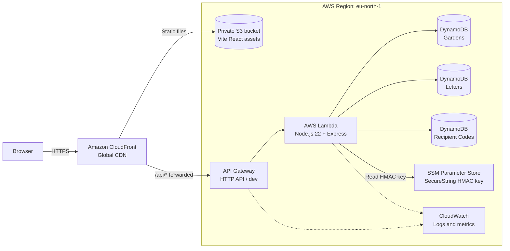

# Architecture

## Context

Letter4You is a React/Vite frontend and an Express/Node.js API. The user can create a private garden, save a management link, write decorated letters, and share a separate recipient access code. The AWS version replaces the original Docker Compose + Prisma/PostgreSQL runtime with managed services. This is an application **re-architecture**, not a claimed transfer of existing PostgreSQL records.

## Runtime topology

**Important:** CloudFront is a **global** service and is not located inside a Stockholm availability zone or VPC. The S3 bucket is private, served via Origin Access Control (OAC); API Gateway is a **separate origin** for `/api/*` requests. Browser requests do **not** flow through S3 into API Gateway. The CloudFront API origin uses stage path `/dev`.

## A browser request, step by step

1. A user loads the site over HTTPS from CloudFront. The CDN requests static React assets from private S3 when necessary.
2. React makes same-origin `/api/*` HTTP requests. CloudFront forwards those requests to API Gateway; the API behavior has caching disabled.
3. The HTTP API invokes a Lambda function running Node.js 22. `backend/src/lambda.js` adapts Express through `serverless-http` and handles stage-prefix normalization for API Gateway v2 events.
4. Express routes under `/api/vaults` validate inputs (Zod), check management tokens for privileged actions, and perform DynamoDB operations through AWS SDK v3.
5. The Lambda resolves a SecureString from SSM Parameter Store for recipient-code HMAC operations and caches it in memory across warm invocations.
6. Lambda metrics/logs and API Gateway metrics/access logs provide operational visibility through CloudWatch. The API also has a direct `/dev/health` endpoint.

## Infrastructure boundaries

| Component | CloudFormation stack | Repository template |
| --- | --- | --- |
| Three DynamoDB tables | `letter4you-dev-db` | [`infra/template.yaml`](../infra/template.yaml) |
| Lambda and HTTP API | `letter4you-dev-api` | [`infra/api-template.yaml`](../infra/api-template.yaml) |
| Private S3, CloudFront distribution, OAC and SPA rewrite function | `letter4you-dev-web` | [`infra/frontend-template.yaml`](../infra/frontend-template.yaml) |
| Backend CI/CD and scoped roles | `letter4you-dev-backend-cicd` | [`infra/backend-cicd-template.yaml`](../infra/backend-cicd-template.yaml) |

The **frontend CodePipeline** called `letter4you-console-lab` was created in the AWS Console and is not managed by the backend pipeline CloudFormation stack. CloudWatch dashboard `letter4you-dev-overview` and access log group `/aws/apigateway/letter4you-dev-access` are also Console-configured resources.

## Architectural trade-offs

- **Lambda + Express:** retains a known REST application and avoids an EC2/ECS runtime; incurs function cold-start/runtime and timeout constraints.
- **DynamoDB:** no database VM and on-demand capacity, but data access has been redesigned around partition/sort keys, transactions, and targeted queries instead of relational joins.
- **One backend Lambda:** simpler deployment for a modest application. The project does not claim independent microservice scaling.
- **Static S3 + CloudFront:** no frontend VM, private storage and HTTPS. Correct cache invalidation/versioning still needs checking in the live Console pipeline.
- **No custom VPC/subnets/NAT for Lambda:** none are required by the current implementation. Do not add imaginary networking constructs to architecture diagrams.

## Deployment relationship

GitHub source is built by two separate AWS CodePipeline workflows. The frontend deployment publishes compiled assets to the **existing S3 website bucket**. The backend deployment executes an approved **CloudFormation change set** to update the existing Lambda/API stack. Post-deployment smoke tests call the real API; they do not deploy a second API or a staging database.
