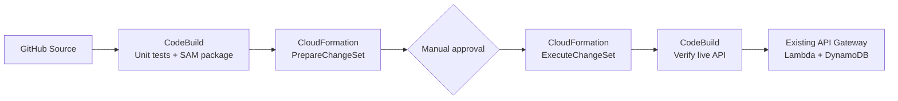
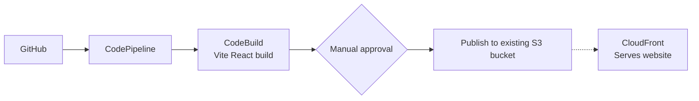

# CI/CD and Release Architecture

Letter4You uses AWS CodeConnections (GitHub), CodePipeline and CodeBuild for delivery. The frontend and backend pipelines are **separate** because they produce different artifacts: a static React bundle and a packaged Lambda/SAM template. Both have a manual deployment gate.

## Backend pipeline — six stages

CloudFormation definition: [`infra/backend-cicd-template.yaml`](../infra/backend-cicd-template.yaml). Expected pipeline name: `letter4you-dev-backend-cicd-pipeline`.



| Stage | AWS action | Practical result |
| --- | --- | --- |
| Source | `CodeStarSourceConnection` | Downloads selected GitHub branch as a source artifact; `DetectChanges: true` is configured in the template |
| Build | `BackendBuildProject` / CodeBuild | Runs syntax checks, Node unit tests, `sam validate`, `sam build`, and `sam package` |
| PrepareChangeSet | CloudFormation `CHANGE_SET_REPLACE` | Prepares a reviewable change set for **existing** `letter4you-dev-api` stack |
| Approve | CodePipeline manual approval | Engineer reviews proposed changes before deployment |
| Deploy | CloudFormation `CHANGE_SET_EXECUTE` | Executes the approved change set |
| Verify | `BackendBuildProject` reused via buildspec override | Calls real `dev` API and asserts application behavior; failing verification marks pipeline failed, without automatic rollback |

**Buildspecs:** [`backend-buildspec.yml`](../backend-buildspec.yml) packages the Lambda; [`backend-smoke-buildspec.yml`](../backend-smoke-buildspec.yml) invokes [`backend/scripts/smoke-cloud-api.mjs`](../backend/scripts/smoke-cloud-api.mjs). The CodeBuild project is intentionally reused for the two purposes; the Verify action uses `BuildspecOverride` and an `API_BASE_URL` environment variable.

### What gets tested

Pre-deployment `npm test --prefix backend` runs [`backend/tests/validators.unit.test.mjs`](../backend/tests/validators.unit.test.mjs): Zod validation, recipient-code normalization, and management-token generation. It is a **small unit test suite**, not a complete end-to-end suite.

After deployment, the smoke script uses real API Gateway/Lambda/DynamoDB. It checks `/health`, `/health/db`, creates a synthetic garden, rejects a wrong management token, writes a letter, retries that letter with the same idempotency key, unlocks the garden with a recipient code, and deletes synthetic data. A failed cleanup is surfaced as a failure. It does **not** spin up a new DynamoDB Local database or separate AWS staging stack.

### Change-set collision / approval caveat

The CloudFormation actions use the fixed name `letter4you-backend-cicd`. On November 19, an execution failed in **Deploy** with `ChangeSetNotFound` after Build, PrepareChangeSet and Approve succeeded. A plausible cause is another execution replacing/deleting the change set while an earlier execution awaited approval; it has **not been definitively proven** without comparing execution histories and CloudFormation events.

**Operational rule:** do not approve overlapping executions against the same target stack. Review the correct execution, its source revision, and the actual change-set status. The pipeline is not considered collision-safe until the naming/concurrency behavior is addressed; a green Build is not evidence of a successful deploy.

## Frontend pipeline — Console configured

Named `letter4you-console-lab` in the development account. **Its live definition is not included in an active frontend CI/CD CloudFormation template**, unlike the backend pipeline.



Root [`buildspec.yml`](../buildspec.yml) installs frontend and backend dependencies, runs a few backend syntax checks, builds Vite with `VITE_API_URL=/api`, and publishes `frontend/dist` as its artifact. It does **not** currently enforce frontend ESLint or dedicated frontend tests. Deployment uploads the artifact to the existing website bucket. A CloudFront invalidation was performed manually during development; **do not assume it is an automatic pipeline step** until verifying the Console configuration.

## Infrastructure permissions and ownership

The backend pipeline stack provisions an artifact bucket, CodeBuild build project, CloudWatch build logs, and several **scoped roles**:

- CodePipeline role: read GitHub through the connection, access artifacts, start CodeBuild, prepare and execute changes on the designated stack.
- CodeBuild role: logs and access to its artifact bucket.
- CloudFormation execution role: limited to the designated Lambda/API stack, relevant IAM Lambda role and packaged artifacts.

Do not delete `letter4you-dev-backend-cicd` or its execution role without first checking which service role is attached to `letter4you-dev-api`. Deleting a role used for stack updates can make future updates difficult.

## How to inspect the active pipeline

```bash
aws codepipeline list-pipeline-executions \
  --pipeline-name letter4you-dev-backend-cicd-pipeline \
  --region eu-north-1 --max-results 5 \
  --query 'pipelineExecutionSummaries[].[pipelineExecutionId,status,sourceRevisions[0].revisionId]' \
  --output table

aws codepipeline get-pipeline-state \
  --name letter4you-dev-backend-cicd-pipeline \
  --region eu-north-1 \
  --query 'stageStates[].[stageName,latestExecution.status]' \
  --output table
```

`get-pipeline-state` reports each stage's **latest action**; confirm an individual execution's overall `Succeeded` status before claiming that one execution passed all six stages.

### Source branch after merge

The template's `Branch` parameter defaults to `feature/aws-serverless-dynamodb`, even though the migration has since been merged into `main`. Check the **live stack parameter / Console pipeline source**, not only the default in Git. Update the deployed backend pipeline by a reviewed CloudFormation change set and the Console frontend source to `main` when appropriate; avoid creating a second pipeline.

See [Operations](operations.md) for failure diagnosis and [Infrastructure](infrastructure.md) for safe stack review.
